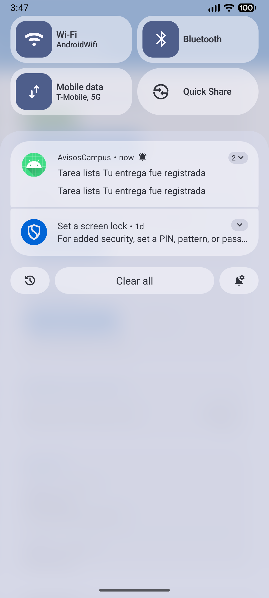
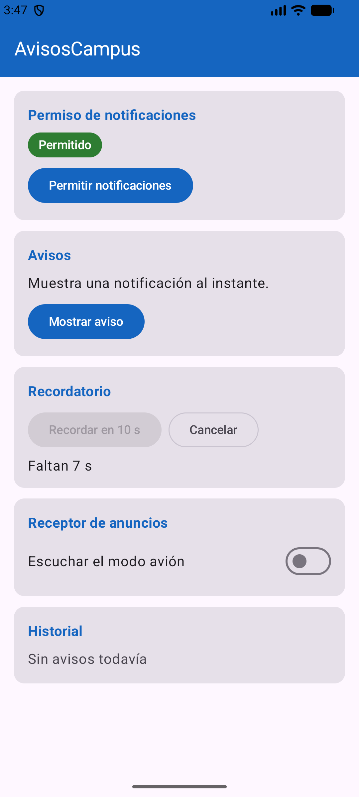
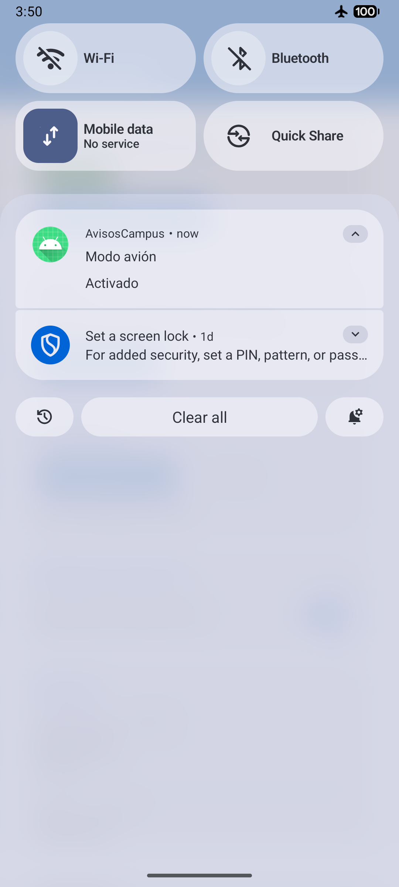
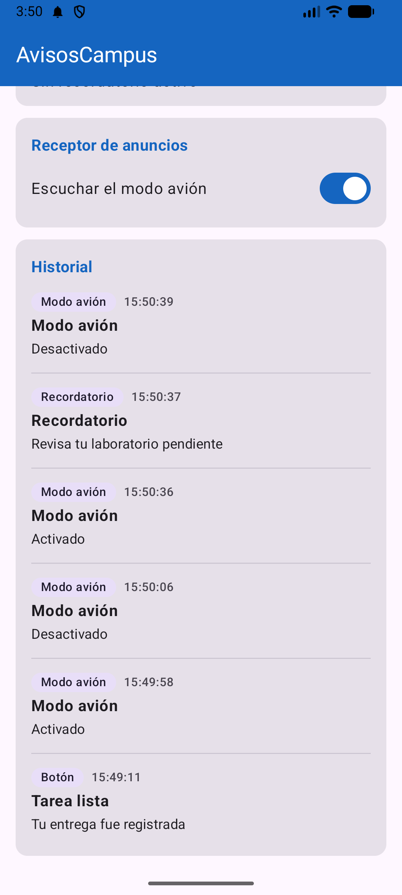
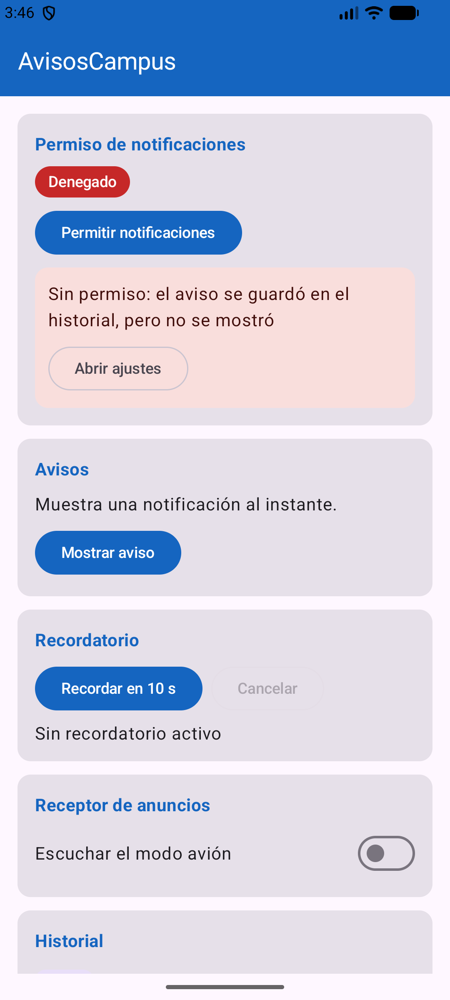

# AvisosCampus

App Android (Kotlin + Jetpack Compose + Material 3) que muestra notificaciones locales y escucha anuncios del sistema.

- **Mostrar aviso**: notificación inmediata «Tarea lista».
- **Recordatorio**: aviso a los 10 s con cuenta regresiva y opción de cancelar (corrutinas).
- **Receptor de anuncios**: `BroadcastReceiver` que avisa cuando se activa o desactiva el modo avión.
- **Historial**: lista de todos los avisos, con lo más reciente arriba.
- **Permiso denegado**: la app no se cierra, guarda el aviso y ofrece abrir Ajustes.

Arquitectura **MVVM + Repository**. Solo datos ficticios.

## Estructura de paquetes

```
com.tecsup.avisoscampus/
├── AvisosApp.kt                 Application: crea el canal
├── MainActivity.kt
├── model/
│   └── Modelos.kt               Aviso, Origen, PermisoUi
├── data/
│   └── AvisosRepository.kt      interface + AvisosRepositoryMemoria
├── notificacion/
│   └── Notificador.kt           canal, permiso y mostrar
├── receiver/
│   └── ModoAvionReceiver.kt     escucha ACTION_AIRPLANE_MODE_CHANGED
├── viewmodel/
│   ├── AvisosViewModel.kt
│   └── AvisosViewModelFactory.kt
└── ui/
    ├── PantallaAvisos.kt
    ├── HistorialAvisos.kt
    └── theme/
```

## Diagrama MVVM

```
View (PantallaAvisos)
   | eventos: botones, switch          ^ collectAsState()
   v                                   |
ViewModel (AvisosViewModel) --- StateFlow (avisos, permiso, faltan, escuchandoAvion, mensaje) --->
   | registra el aviso                 | emite: eventos (SharedFlow<Aviso>)
   v                                   v
AvisosRepository (interface)        View recibe el evento y llama a
  -> AvisosRepositoryMemoria        Notificador.mostrar(context, aviso)
```

| Capa | Conoce a | No debe |
|---|---|---|
| View (`ui/`) | Su ViewModel y el Notificador | Decidir qué se avisa ni guardar el historial |
| ViewModel | Solo la interface del Repository | Usar Context, NotificationManager ni BroadcastReceiver |
| Repository | Nada de la UI | Usar Context |
| Notificador | El sistema (canal, NotificationManager) | Guardar estado de la app |

## Capturas

| Notificación en el panel | Recordatorio | Modo avión |
|---|---|---|
|  |  |  |

| Historial | Permiso denegado |
|---|---|
|  |  |

## Pruebas de aceptación (emulador API 37)

| Prueba | Resultado | OK |
|---|---|---|
| Ajustes → Apps → AvisosCampus → Notificaciones | Existe el canal Avisos | ✅ |
| Pulsar Permitir notificaciones | Aparece el cuadro de Android y la etiqueta cambia | ✅ |
| Pulsar Mostrar aviso | Aparece la notificación Tarea lista | ✅ |
| Pulsar Mostrar aviso dos veces | Aparecen dos notificaciones distintas | ✅ |
| Tocar la notificación | Se abre la app y la notificación desaparece | ✅ |
| Recordar en 10 s | Cuenta regresiva y aviso al llegar a 0 | ✅ |
| Recordar y minimizar la app | El aviso llega igual | ✅ |
| Recordar y cancelar | No llega ningún aviso | ✅ |
| Switch activado y cambiar el modo avión | Aviso Activado y luego Desactivado | ✅ |
| Switch desactivado y cambiar el modo avión | No hay aviso | ✅ |
| Permiso denegado y Mostrar aviso | Mensaje de error, aviso en el historial y la app no se cierra | ✅ |
| Rotar la pantalla durante el recordatorio | La cuenta regresiva continúa | ✅ |
| Revisar el código | No hay Context en `viewmodel/` y todo receptor se quita en `onDispose` | ✅ |

## Para pensar

**1. ¿Por qué una notificación necesita un canal y un permiso? ¿Qué pasa si falta cada uno?**
Desde Android 8 (API 26) cada notificación pertenece a un canal, que permite al usuario controlar por categoría la importancia, el sonido o desactivarla. Si el canal no existe, la notificación no se muestra (el sistema la descarta y registra un error). Desde Android 13 (API 33) `POST_NOTIFICATIONS` es un permiso en tiempo de ejecución para que el usuario decida si la app puede molestarle. Sin el permiso, `notify()` no muestra nada; por eso `Notificador.mostrar` lo comprueba antes y devuelve `false`.

**2. ¿Por qué el ViewModel emite un evento y no muestra la notificación él mismo?**
Mostrar una notificación necesita un `Context` y el `NotificationManager`, que son del sistema Android. Si el ViewModel los guardara podría filtrar memoria (sobrevive a la Activity) y dejaría de ser probable sin Android. El ViewModel solo decide qué avisar, lo registra en el Repository y emite un evento de una sola vez (`SharedFlow`); la pantalla, que sí tiene Context, llama al Notificador.

**3. ¿Qué pasa si usas el mismo id en dos notificaciones?**
La segunda reemplaza a la primera: el sistema actualiza la notificación existente en lugar de crear otra. Por eso se usa `aviso.id`, que es distinto para cada aviso.

**4. ¿Por qué onReceive debe ser corto y por qué hay que quitar el receptor al salir?**
`onReceive` se ejecuta en el hilo principal; si tarda demasiado (unos 10 s) el sistema lanza un ANR y la app se congela. Debe solo leer el dato y delegar. El receptor registrado por código mantiene una referencia al Context y a la lambda; si no se quita con `unregisterReceiver` sigue vivo, filtra memoria y puede seguir recibiendo anuncios cuando la pantalla ya no existe. Por eso se quita en `onDispose`.

**5. ¿En qué casos usarías una notificación local y en cuáles una push de Firebase?**
Local: cuando el evento nace en el propio celular (recordatorios, temporizadores, cambios del sistema como el modo avión, una descarga terminada); no necesita internet ni servidor. Push (FCM): cuando el evento nace fuera del celular, en un servidor u otra persona (un mensaje nuevo, una nota publicada, una alerta del campus para todos los alumnos), incluso con la app cerrada.
